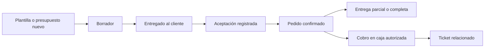
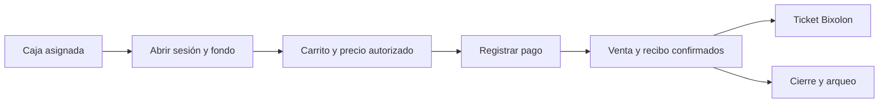

# Diseño funcional y navegación

## 1. Integración y vocabulario

El acceso seguirá siendo el de RFQ_SKU_GMP. Tras iniciar sesión aparecerán solo aplicaciones autorizadas. Se mantienen **SKU Compras**, **SKU Ventas**, **Requisiciones** y sus reportes; se agregan **VentasIns** y **Expendios**. No se crea otra aplicación ni otro ejecutable comercial independiente.

Se distinguen cuatro conceptos que el término “machote” podría mezclar:

| Concepto | Función |
| --- | --- |
| Maestro de productos | Archivo para alta/actualización controlada de atributos comerciales de productos vinculados al SKU existente. |
| Plantilla de presupuesto | Conjunto reutilizable de productos, secciones, notas y condiciones que inicia un presupuesto. |
| Formato de impresión | Diseño del documento de presupuesto/pedido o del ticket; no altera productos ni precios. |
| Layout de Expendios | Asignación de productos/categorías a sucursal/caja y su orden visual. No importa cobros como si fueran ventas reales. |

**Módulo ID PDV A01–A22** sigue siendo la clasificación de productos existente. No identifica una sucursal, caja, usuario o sesión. Las cajas tendrán identificadores propios.

## 2. Menús de Odoo 14 y su adaptación

La estructura verificada de Ventas 14 agrupa operaciones, catálogo, análisis y ajustes [O1](FUENTES.md). Se propone esta jerarquía, con etiquetas en español:

```text
Selector de aplicaciones RFQ_SKU_GMP
├─ SKU Compras / SKU Ventas / Requisiciones [actuales]
├─ VentasIns
│  ├─ Pedidos → Presupuestos · Pedidos · Clientes
│  ├─ Productos → Productos · Listas de precios · Importar maestro
│  ├─ Informes → Dashboard · Ventas y presupuestos
│  └─ Configuración → Plantillas de presupuesto · Series · Condiciones
├─ Expendios
│  ├─ Dashboard → Cajas asignadas · Abrir / continuar caja
│  ├─ Punto de Venta → Pantalla de caja [dentro de Expendios]
│  ├─ Pedidos → Tickets · Sesiones · Clientes
│  ├─ Productos → Catálogo del expendio · Listas de precios · Cargar layout
│  ├─ Informes → Ventas · Detalle de ventas · Cierres
│  └─ Configuración → Puntos de venta · Pagos · Recibos · Series
└─ Administración [actual] → Usuarios · Accesos por perfil · Respaldos
```

La organización de Expendios adapta los menús comunes de TPV 14 y su dashboard [O4–O6](FUENTES.md). **Punto de Venta no será una aplicación separada fuera de Expendios.** “Importar maestro”, “Cargar layout”, la entrada explícita a caja y el dashboard comercial son adaptaciones GMP. Equipos de ventas, variantes, facturación y otros menús de Odoo no se mostrarán como funcionalidades disponibles sin implementación y autorización de alcance.

### Composición visual

- **Escritorio:** selector de aplicaciones, barra superior con nombre de módulo y menús desplegables; controles de búsqueda, filtros y agrupación; listas compactas y formularios centrales. Barra púrpura, acciones primarias verdeazulado, secundarios discretos y estados alineados con las acciones.
- **Formulario comercial:** acciones Crear/Editar/Guardar, confirmar pedido e imprimir; cliente y condiciones arriba; líneas/notas en pestañas; subtotal y total a la derecha; historial operativo debajo. “Enviar” registra una entrega manual del presupuesto en la primera etapa; no presume envío de correo.
- **TPV:** pedido a la izquierda y categorías/tarjetas de productos a la derecha; cantidad, cliente, lista y pago próximos al pedido; cliente/pago a la izquierda del teclado numérico, como en la referencia pública 14.0. En tablet se conserva esta distribución cuando haya espacio; en celular se alterna Catálogo/Pedido sin perder la selección.
- **Navegación actual:** el selector lleva a los módulos existentes con su interfaz actual. El objetivo de semejanza con Enterprise 14 aplica a los módulos nuevos; no se reemplaza de golpe el menú de requisiciones.
- **Cotejo visual:** lista de presupuestos, formulario, dashboard de cajas, caja, pago, documento y ticket a 1440×900, 1024×768 y 390×844. Capturas comparables antes de aceptar el diseño. El prototipo no demuestra fidelidad exacta a Enterprise; véase [alcance de las fuentes](FUENTES.md).

## 3. Perfiles y accesos

Se agregan perfiles **VentasIns** (`ventasins`) y **Expendios** (`expendios`). El perfil actual **Ventas** (`ventas`) conserva sus funciones de SKU; no se renombra ni se convierte silenciosamente en vendedor comercial.

En **Accesos por perfil**, Superadministrador controlará dos niveles:

1. Visibilidad/consulta de **VentasIns** y **Expendios / Punto de Venta**.
2. Acciones: presupuestar, confirmar pedidos, operar caja, consultar reportes, importar maestros, administrar listas/precios y autorizar excepciones.

Ver Expendios no concede abrir caja, cobrar, ver costos ni administrar. Desmarcar el módulo revoca también el acceso por URL/API, exportaciones y reimpresiones. Las acciones quedan inactivas si no se permite consultar su módulo.

| Perfil | Operación propuesta si Sistemas habilita el módulo | Alcance y límites |
| --- | --- | --- |
| VentasIns | Clientes asignados, presupuestos, pedidos e impresión comercial. | Sucursales/clientes asignados; documentos propios por defecto. Sin administración de precios, costos, caja ni respaldos. |
| Expendios | Abrir/continuar caja asignada, cobrar, cerrar sesión propia e imprimir tickets. | Sucursal/caja/sesión asignadas. Sin modificar precios base, importar maestros o administrar perfiles. |
| Superadministrador | Administración y revisión global. | Control de accesos; habilitación por sucursal y caja; auditoría. |
| AUXTI | Soporte y configuración comercial autorizada. | Conserva las restricciones actuales de bajas/restauración y no cambia accesos por perfil ni se asigna Superadministrador. |
| Gerente | Dashboard y supervisión comercial, excepciones y cierres autorizados. | Solo módulos habilitados; respetar alcance de sucursales y mantener las reglas actuales de requisiciones. |
| Ventas, Compras, Alta, Visualizador, Almacenista, Requisición | Solo consulta comercial si se habilita expresamente; operación requiere permiso específico. | Ningún acceso comercial nuevo por pertenecer a un perfil actual. Requisición mantiene su aislamiento y la prohibición de ver costos. |

Los valores anteriores son **defaults propuestos**, no altas de cuentas. Los módulos comerciales empiezan deshabilitados para perfiles actuales salvo Superadministrador. En Usuarios se asignan sucursales, cajas y, para VentasIns, cartera/equipo; no basta el checkbox del módulo. Un usuario sin alcance recibe una pantalla de asignación pendiente, nunca acceso a todas las sucursales.

## 4. Presupuestos y pedidos

Las plantillas reutilizables siguen el concepto de Odoo 14 [O2](FUENTES.md), con condiciones GMP propias.



El presupuesto registra cliente, sucursal, vendedor, vigencia, moneda, lista y revisión de precios, líneas, cantidades y unidad de venta, impuestos, descuentos y términos. La confirmación crea un pedido una sola vez mediante clave de idempotencia y conserva la referencia al presupuesto. Si se duplica para otra negociación se genera un documento nuevo, no se pisa el anterior.

Estados propuestos de presupuesto: BORRADOR, ENTREGADO, ACEPTADO, VENCIDO, CANCELADO. Pedido: CONFIRMADO, ENTREGA_PARCIAL, ENTREGADO, CANCELADO. Pago es un estado independiente: PENDIENTE, PARCIAL, PAGADO. Una entrega o aceptación no demuestra cobro. Cambios después de confirmar crean revisión o solicitud de autorización; conservan fecha original, folio e historial.

Un pedido cobrado en Expendios se vincula al ticket y al saldo pendiente. No se vuelve a sumar como una venta distinta por pasar de presupuesto a pedido y luego a ticket. Anticipos y reembolsos deben referenciar el documento de origen.

## 5. Precios

Odoo 14 proporciona listas y reglas de precios por segmentos/clientes [O3](FUENTES.md). Para GMP se propone un motor compartido por VentasIns y Expendios:

1. Validar que la lista esté activa, vigente y permitida para canal y sucursal/caja.
2. Resolver lista explícita autorizada; si no, lista del cliente permitida; después lista predeterminada de la sucursal/canal. Si falta precio válido, bloquear confirmación/cobro y mostrar el motivo.
3. En esa lista, resolver SKU + unidad de venta y rango de cantidad. Reglas ambiguas o vigencias superpuestas se rechazan al cargar; no decide el orden de las filas.
4. Mostrar si el precio incluye impuestos y calcular todo en el servidor con decimales. La unidad de venta no se infiere de la unidad de compra ni de UM_ENTREGA de requisiciones.
5. Guardar en cada línea precio, moneda, unidad, impuestos, descuento, lista y revisión aplicadas. Cambiar una lista mañana no cambia un pedido, cobro o ticket histórico.

VentasIns y Expendios seleccionan solo listas asignadas. Cambios manuales de precio, descuentos fuera de límite o cambio de lista restringida necesitan permiso/autorización; ningún precio enviado por el navegador se acepta sin validar. Tarifas cero requieren una regla explícita autorizada, no ausencia de dato. Primera etapa: precios fijos, vigencia y tramos de cantidad; fórmulas complejas y promociones quedan para un alcance posterior.

## 6. Expendios y caja

La pantalla de entrada muestra tarjetas de las cajas asignadas con estado Cerrada, Abierta o Cierre pendiente, adaptando el patrón de dashboard 14 [O5](FUENTES.md).



La confirmación de pago guarda venta, líneas, pagos y folio de forma atómica. Reintentar por doble clic o pérdida de respuesta devuelve el mismo resultado. La impresión sucede después: un fallo de impresora no cancela un cobro ni crea otro. Reimprimir conserva folio e importes y registra que es copia [O8](FUENTES.md).

Primera etapa propuesta: efectivo y registro manual de medios autorizados; registrar tarjeta/transferencia no procesa una transacción bancaria. Devoluciones, retiros, diferencias de caja y cancelaciones requieren capacidad y autorización; las ventas cobradas no se borran, se corrigen con movimientos vinculados. No se cierra una caja ajena mediante un identificador conocido.

## 7. Dashboard y presupuesto de ventas

“Presupuesto” se separa en **cotización a cliente** y **meta/presupuesto de ventas**. Se propone incluir ambas vistas para revisión: metas por período/sucursal/canal y cotizaciones como documentos.

| Indicador | Base propuesta |
| --- | --- |
| Cotizado vigente | Presupuestos vigentes entregados; separado de ingresos. |
| Conversión | Presupuestos aceptados / entregados de una cohorte y período definidos. |
| Pedidos confirmados | Pedidos no cancelados; separado de cobros. |
| Venta TPV neta | Ventas cobradas menos devoluciones autorizadas, con filtro de fecha definido. |
| Cobrado / saldo | Pagos efectivamente registrados y saldo por documento; anticipos sin duplicar. |
| Meta y cumplimiento | Meta comercial contra la métrica elegida explícitamente, por sucursal/canal/período. |
| Caja | Efectivo esperado, contado y diferencia; sesión independiente de fecha del pedido. |

Filtros y detalle: período → canal → sucursal → vendedor/caja → cliente/producto → documento. Cada tarjeta indicará si incluye impuestos y cuál fecha usa. Las cantidades solo se suman por unidad compatible; monedas separadas hasta definir conversión. No se propone margen/utilidad hasta disponer del costo del producto de venta: el costo de insumos de requisiciones no equivale al costo del producto terminado.

## 8. Formatos de impresión

**Documento comercial, composición Odoo 14 [O7](FUENTES.md):** logo GMP, empresa, cliente/direcciones, título Presupuesto/Pedido y folio, fecha y vigencia, vendedor, referencia, tabla SKU/descripción/cantidad/unidad/precio/descuento/importes, subtotal, impuestos, total, condiciones y aceptación/firma. Carta propuesta y A4 alternativo. Encabezados de tabla repetidos, folios de página y términos después de las líneas. Plantilla versionada; las reimpresiones conservan datos y condiciones históricos.

**Ticket Bixolon:** rollo de 80 mm y contenido de 72 mm, reutilizando la estrategia de impresión existente. Empresa, sucursal/caja/cajero, folio/fecha, cliente si aplica, SKU y descripción legibles, cantidad/unidad/precio, descuentos, total, forma de pago, recibido y cambio, referencias a pedido y pie. En presupuesto se rotula PRESUPUESTO, sin afirmar pago; en venta se identifica el cobro. Firmas solo donde el documento comercial lo requiera, al final.

PDF/documento y ticket deben coincidir con el servidor en importes y permisos. La impresión inicial usa el diálogo del navegador en el equipo cliente y la Bixolon configurada allí; abrir la app por IP no convierte automáticamente una impresora del servidor en impresora del cliente. Impresión silenciosa/ESC-POS y conexiones bancarias requieren un diseño adicional. Este alcance no implementa facturación fiscal, correo automático ni firma electrónica remota.
